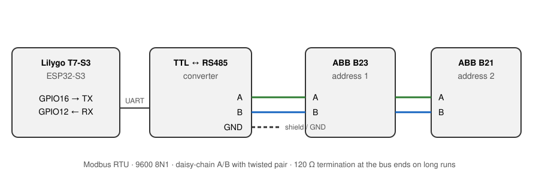
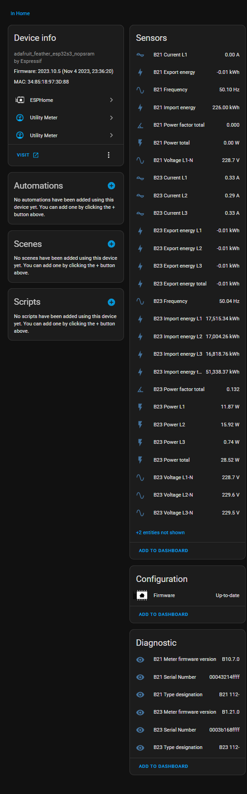

# ESPHome ABB B23 / B21 kWh meters (RS485 / Modbus)

ESPHome configuration that reads an **ABB B23** (3-phase) and an **ABB B21**
(1-phase) kWh meter over one RS485 / Modbus RTU bus with an ESP32 and publishes
the values to Home Assistant.

## Features

- Import and export energy, total and per phase (B23)
- Voltage, current and active power per phase
- Frequency and power factor
- Serial number, firmware version and type designation as diagnostic entities
- Energy sensors with `state_class: total_increasing`, ready for the Home
  Assistant energy dashboard
- Two meters on one bus, one ESP

## Hardware

| Part | Notes |
|---|---|
| [Lilygo T7-S3](https://www.lilygo.cc/products/t7-s3) (ESP32-S3) | any ESP32 works, adjust `board_type` and the pins |
| TTL to RS485 converter ([MAX485](https://www.analog.com/en/products/max485.html)) | see the note on direction control below |
| [ABB B23 112-100](https://new.abb.com/products/2CMA100164R1000/b23-112-100) | 3-phase kWh meter, Modbus RTU |
| [ABB B21 111-100](https://new.abb.com/products/2CMA100149R1000/b21-111-100) | 1-phase kWh meter, Modbus RTU |

| Signal | Lilygo T7-S3 |
|---|---|
| UART TX | GPIO16 |
| UART RX | GPIO12 |

Serial settings: **9600 baud, 8N1**. Addresses: **B23 = 1**, **B21 = 2**.

> 💡 The configuration has no `flow_control_pin`, so it expects a converter
> that switches transmit/receive automatically. With a bare MAX485 module,
> connect DE and RE together to a free GPIO and add
> `flow_control_pin: GPIOxx` under `modbus:`.

## Installation

1. Copy [`abb-b23-b21.yaml`](abb-b23-b21.yaml) into your ESPHome config folder.
2. Make sure `secrets.yaml` contains `wifi_ssid`, `wifi_password` and
   `api_encryption_key`.
3. Set the same baud rate, parity and a unique address on both meters, using
   the meter's own menu.
4. Edit the `substitutions` where your setup differs.
5. Compile and flash with ESPHome, then add the device in Home Assistant
   (**Settings → Devices & services**).

## Configuration (`substitutions`)

| Substitution | Default | Meaning |
|---|---|---|
| `device_name` | `b23-b21` | Hostname |
| `friendly_name` | `ABB B23 B21` | Name of the fallback hotspot |
| `board_type` | `adafruit_feather_esp32s3_nopsram` | ESPHome board, matches the Lilygo T7-S3 |
| `uart_tx_pin` | `16` | TX towards the RS485 converter |
| `uart_rx_pin` | `12` | RX from the RS485 converter |
| `uart_baud` | `9600` | Must match both meters |
| `b23_address` | `0x1` | Modbus address of the B23 |
| `b21_address` | `0x2` | Modbus address of the B21 |
| `update_interval` | `10s` | Poll interval per meter |

## Entities

### Energy

| Entity | B23 | B21 |
|---|---|---|
| Import energy total | ✓ | ✓ (`B21 Import energy`) |
| Export energy total | ✓ | ✓ (`B21 Export energy`) |
| Import energy L1 / L2 / L3 | ✓ | – |
| Export energy L1 / L2 / L3 | ✓ | – |

### Instantaneous values

| Entity | B23 | B21 |
|---|---|---|
| Voltage L1-N | ✓ | ✓ |
| Voltage L2-N / L3-N | ✓ | – |
| Current L1 | ✓ | ✓ |
| Current L2 / L3 | ✓ | – |
| Power total | ✓ | ✓ |
| Power L1 / L2 / L3 | ✓ | – |
| Frequency | ✓ | ✓ |
| Power factor total | ✓ | ✓ |

### Diagnostic

| Entity | B23 | B21 |
|---|---|---|
| Serial Number | ✓ | ✓ |
| Meter firmware version | ✓ | ✓ |
| Type designation | ✓ | ✓ |

All register addresses are in
[`documents/ABB-B23-B21-modbus-registers.md`](../documents/ABB-B23-B21-modbus-registers.md).

Screenshot from Home Assistant:

## Important notes

- ⚠️ A meter returns all bits set for a value it does not have. Without
  export, the export energy can then show a small negative number such as
  `-0.01 kWh`, as in the screenshot.
- The **Type designation** is read with 8 bytes and shows as `B23 112-`. A
  larger `response_size` gives the full text if the meter provides it.
- Active power is signed: negative means export.

## Modbus timing

| | |
|---|---|
| Poll interval | 10 s per meter |
| Identification registers | every 60th poll (`skip_updates: 60`) |

## Credits

- [systeembeheerder](https://github.com/systeembeheerder) – source of
  inspiration and the ABB related code
- [fonske (AKA AUijtdehaag)](https://github.com/fonske) – the hardware and
  related code

## Disclaimer

This project is not affiliated with ABB. Use at your own risk. Work on mains
installations only if you are qualified to do so.
